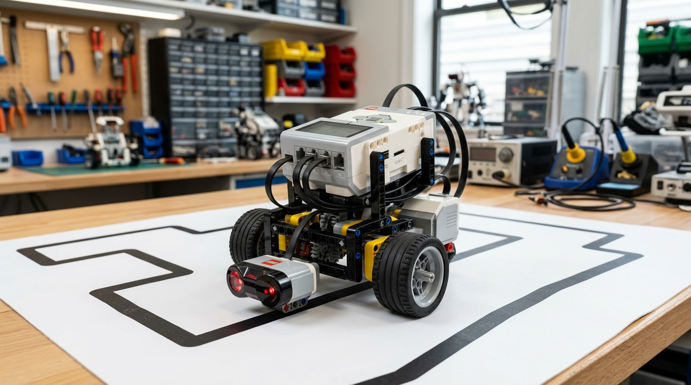
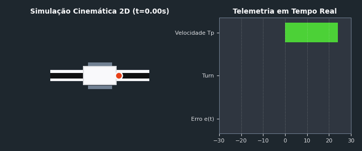
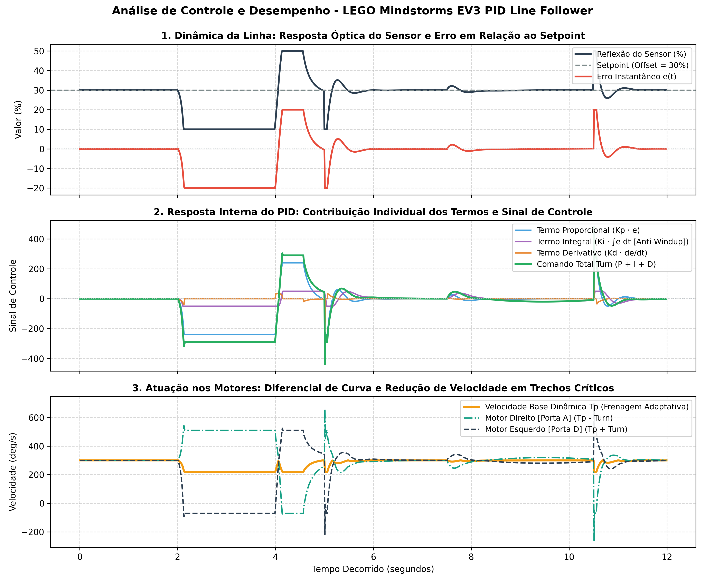

# EV3 Advanced PID Line Follower

[](LICENSE)
[](https://www.lego.com/mindstorms)
[](https://pybricks.com/)
[](https://www.python.org/)

High-performance autonomous navigation system for line-follower robots using the LEGO Mindstorms EV3 brick and Pybricks (MicroPython). This project features time-domain real-time PID control ($dt$), dynamic corner braking, interactive on-screen optical calibration, anti-windup protection, and a **Python kinematic simulator with automatic gain tuning (Twiddle)**.

---

<p align="center">
  
  <br>
  <em>Physical LEGO Mindstorms EV3 line follower robot on the calibration and test track.</em>
</p>

---

## Demonstration and Visualization

<p align="center">
  
  <br>
  <em>2D kinematic simulation showing real-time error telemetry, steering turn command, and dynamic speed.</em>
</p>

### Video Demonstration
> [!NOTE]
> To watch the robot navigate a physical competition track at top speed with adaptive corner braking:
> - **Robot Track Video:** [Watch on YouTube / Demo](https://youtube.com) *(replace with your recorded demonstration link)*

---

## Key Features

* **Time-Domain PID Control:** The derivative term is computed using true elapsed time ($dt$) via `StopWatch`, eliminating sampling-rate jitter and loop timing fluctuations.
* **Dynamic Velocity (Adaptive Braking):** Automatic speed attenuation ($T_p$) proportional to track error on sharp turns, restoring full acceleration on straightaways.
* **Interactive On-Screen Calibration:** Guided setup on the EV3 LCD display to sample white and black reflections, automatically computing the optimal balance point (*offset* setpoint).
* **Anti-Windup Protection:** Integral clamping boundaries ($\pm 50$) preventing windup accumulation and overshoot when recovering from sharp turns or perturbations.
* **Integrated Python Simulator:** Model, validate, and benchmark robot kinematics and response dynamics without needing the physical robot.
* **Gain Auto-tuning (Twiddle):** Built-in coordinate ascent optimization routine to automatically converge on optimal $K_p$, $K_i$, and $K_d$ gains.

---

## Hardware Requirements and Port Mapping

<p align="center">
  
</p>

| Component | Quantity | Role / Description |
| :--- | :---: | :--- |
| **EV3 Intelligent Brick** | 1x | Main controller running Pybricks MicroPython |
| **EV3 Large Motors** | 2x | Differential drive propulsion with 56 mm rubber wheels |
| **EV3 Color Sensor** | 1x | Ground-facing optical reflection sensor (~65 mm ahead of axle) |
| **Connection Cables** | 3x | Standard EV3 RJ12 cables |

**Port Configuration:**
* **Port A:** Right Drive Motor
* **Port D:** Left Drive Motor
* **Port S1:** Color Sensor (mounted perpendicular to the floor)

---

## How to Run

### 1. On Physical LEGO EV3 Hardware

1. Flash [Pybricks MicroPython](https://pybricks.com/) onto a MicroSD card and boot the EV3 brick.
2. Connect motors and the color sensor according to the port mapping above.
3. Open this workspace in VS Code with the Pybricks EV3 extension.
4. Connect the EV3 brick via Bluetooth or USB and transfer `main.py`.
5. Run the program and follow the step-by-step calibration prompt on the brick display:
   * Place the sensor over the **WHITE** background and press any button.
   * Place the sensor over the **BLACK** line and press any button.
6. The brick will sound a confirmation double-beep and immediately commence autonomous line following.

### 2. In the Python Simulator (No Physical Robot Required)

The standalone simulator is located in `simulator/pid_simulator.py` and uses Python 3 (`numpy`, `matplotlib`, and `Pillow`):

```bash
# Install simulator dependencies (if needed)
pip install numpy matplotlib pillow

# Run the default simulation benchmark and export graphs to assets/
python3 simulator/pid_simulator.py --run

# Print the experimental PID tuning benchmark table
python3 simulator/pid_simulator.py --tune-table

# Run the Twiddle auto-tuning optimizer to find optimal PID gains
python3 simulator/pid_simulator.py --autotune
```

---

## PID Error & Control Output Telemetry

Running the simulator exports a publication-ready graph to `assets/pid_graph.png`:

<p align="center">
  
</p>

### Plot Overview:
1. **Line Tracking Dynamics (Top Plot):** Illustrates optical sensor reflection relative to the setpoint (*offset* = 30%) and instantaneous error $e(t)$.
2. **PID Internal Decomposition (Middle Plot):** Deconstructs individual terms — Proportional ($K_p \cdot e$), Anti-windup Integral ($K_i \cdot \int e\,dt$), and Derivative ($K_d \cdot \frac{de}{dt}$) — combining into the final steering command `turn`.
3. **Motor Actuation (Bottom Plot):** Shows adaptive braking — as $|e(t)|$ spikes in tight corners, base speed $T_p$ decelerates proportionally, preventing wheel slip and loss of track adhesion.

---

## Experimental Tuning Table (PID Tuning Benchmark)

Empirical testing data collected on a standard competition track (19 mm black line on white surface, offset 30%):

| # | $K_p$ | $K_i$ | $K_d$ | Base Speed ($T_p$) | ISE | Chatter Score | Observed Behavior / Diagnostic | Classification |
| :---: | :---: | :---: | :---: | :---: | :---: | :---: | :--- | :---: |
| **1** | 5.0 | 0.0 | 0.0 | 200 | 3870.9 | Low (24.4) | Under-reactive response; strays off-track on medium corners. | Underdamped |
| **2** | 25.0 | 0.0 | 0.0 | 250 | 470.0 | Very High (6884.6) | Severe continuous hunting on straightaways; mechanical wheel chatter. | Unstable |
| **3** | 12.0 | 0.0 | 30.0 | 250 | 1199.0 | Medium (1386.1) | Stable on straights, but oscillates when exiting sharp radius turns. | Insufficient $K_d$ |
| **4** | 12.0 | 0.0 | 180.0 | 250 | 1179.2 | High (27099.4) | Amplified derivative noise; noticeable motor strain and vibration. | Excessive $K_d$ |
| **5** | 12.0 | 5.0 | 116.0 | 250 | 473.3 | High (8738.8) | Integral accumulation (*windup*); substantial overshoot exiting curves. | Excessive $K_i$ |
| **6** | **12.0** | **1.0** | **116.0** | **300** | **1045.4** | **Smooth (6151.3)** | **Smooth trajectory tracking, rapid disturbance rejection, active braking.** | **Optimal Configuration** |

### Recommended Tuning Methodology:
1. Zero $K_i$ and $K_d$. Gradually increase $K_p$ until the robot tracks gentle curves with slight baseline oscillation.
2. Introduce derivative gain $K_d$ to dampen oscillation and provide predictive steering ahead of sharp turns.
3. Add a moderate $K_i$ term to eliminate steady-state offset in long continuous curves while keeping anti-windup clamping active.
4. Tune `self.fator_frenagem` and `self.tp_maximo` to match tire grip and track friction.

---

## Auto-tuning Mode (Twiddle)

The simulator includes a Coordinate Ascent (*Twiddle*) auto-tuner. Execute:

```bash
python3 simulator/pid_simulator.py --autotune
```

The optimizer performs closed-loop simulated runs on the synthetic benchmark track, minimizing a weighted cost of Integral Square Error (ISE) and motor chatter. The resulting gains can be pasted directly into `main.py`.

---

## Repository Structure

```text
EV3-Advanced-PID-Line-Follower/
├── .gitignore               # Ignored build/IDE/cache files
├── LICENSE                  # MIT License
├── README.md                # Portuguese Documentation
├── README_EN.md             # English Documentation
├── main.py                  # Main Pybricks MicroPython EV3 firmware
├── assets/
│   ├── pid_graph.png        # Telemetry and PID performance graphs
│   ├── robot_assembly.jpg   # Physical robot assembly photograph
│   └── simulation.gif       # 2D kinematic simulation animation
└── simulator/
    └── pid_simulator.py     # Python kinematics simulator with Twiddle optimizer
```

---

## License

This project is licensed under the [MIT License](LICENSE).